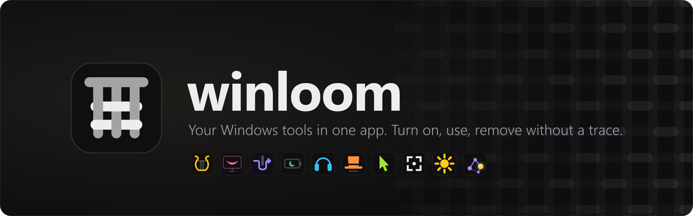
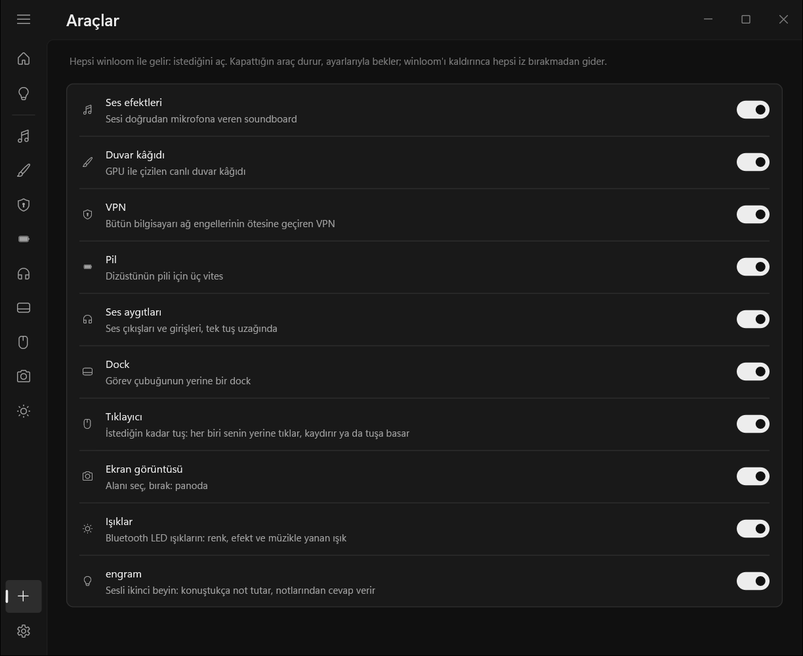
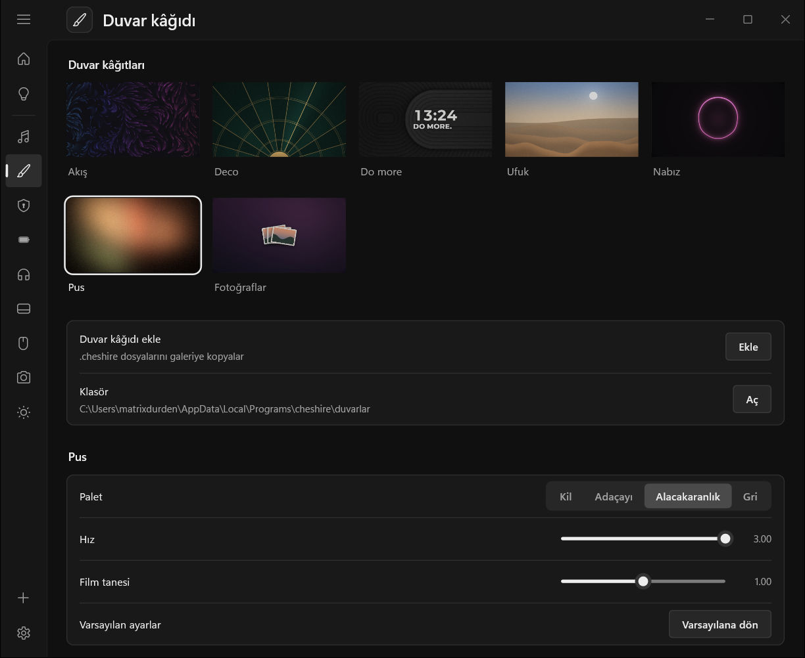

<p align="center">
  
</p>

<p align="center">
  <a href="https://github.com/matrixdurden/winloom/releases/latest"></a>
  
  
  <a href="LICENSE"></a>
</p>

<p align="center"><b>English</b> · <a href="README.tr.md">Türkçe</a></p>

<br>

A soundboard here, a wallpaper app there, a VPN client, an auto clicker, something for the battery… On Windows, every small need is its own program: its own installer, its own tray icon, its own updater, and its own leftovers when you remove it.

**winloom is one app with all of them inside.** Ten tools share one window, one tray icon and one updater. Turn on the ones you want; the rest stay out of your way. And when you are done, winloom takes everything back off your system, down to the last registry key.

## Install

Paste into PowerShell:

```powershell
irm https://github.com/matrixdurden/winloom/raw/main/install.ps1 | iex
```

That is all: no administrator rights, no setup wizard. From then on winloom keeps itself up to date: it downloads new versions, verifies them and installs them the next time it starts (or right away from Settings; automatic updates can be turned off).

## What's inside

Every tool ships with winloom and starts off. Turn on the ones you want on the **Tools** page: each one gets a page in the sidebar and its own entry in the Start menu, so searching for "Battery" opens winloom right on it.

### Sound

| | | |
|:---:|---|---|
|  | **Soundboard** | Plays sounds straight into your microphone, without a virtual microphone: Discord, games, OBS and anything else that listens to the mic hears them. Search Myinstants without leaving the page (preview on your headphones, add with one click), and press `Ctrl+Alt+L` to keep the last 10 seconds your computer played. |
|  | **Audio devices** | Every output and input in one list; click one to make it the default. One key jumps to the next output (`Ctrl+Alt+O`) or input (`Ctrl+Alt+I`), another mutes the microphone (`Ctrl+Alt+K`). When your headphones drop, the music pauses instead of carrying on from the laptop speakers. |

### Desktop

| | | |
|:---:|---|---|
|  | **Wallpaper** | Live wallpapers drawn by your GPU behind the desktop icons. The Photos wallpaper turns a folder of your own pictures into a slideshow with nine transitions (dissolve, circle, glitch…) and a slow drift on each photo. Put a clock, the date, the weather or your own words on any wallpaper and drag them into place on a small preview of your screen. It pauses by itself in fullscreen and on battery. |
|  | **Dock** | Replaces the taskbar with a floating dock in the Windows 11 look: pinned and running apps in one bar, with Wi-Fi, sound, battery and the clock at its end. Icons grow under the cursor, apps bounce when they need you, hovering shows live window previews, and you rearrange by dragging. Fling the cursor into the top-left corner for all windows, the bottom-right for the desktop; `Win+1…9` opens apps in dock order. Turn it off and the taskbar comes back exactly as it was. |
|  | **Screenshot** | `Print Screen` freezes the screen. Select an area (or click for all of it), resize it by its edges, move it, and draw on it with a pen or rectangles in six colors. `Ctrl+C` copies, `Ctrl+S` saves a PNG. Nothing else on screen gets in the way. |

### Network

| | | |
|:---:|---|---|
|  | **VPN** | Takes your whole computer past network blocks, two ways: through **your own server**, disguised as ordinary HTTPS to a well-known site, or **with no server at all** in DPI mode, which hides the site names from the filter. A network test tells you which one works where you are. Its engine also runs on its own, on a Linux server and on phones: see [winloom VPN](araclar/tunnel/motor/). |

### Power and input

| | | |
|:---:|---|---|
|  | **Battery** | Three gears for a laptop: plugged in, out for an hour or two, and survival. It shifts by itself when the charger comes and goes, keeps the discrete GPU asleep on battery, and learns how long each gear really lasts. |
|  | **Clicker** | An auto clicker with as many trigger keys as you like. Each key has its own action (any mouse button, the wheel, or a keyboard key with Ctrl / Alt / Shift), its own mode (hold, or press to start and again to stop), its own speed from once every two seconds to a hundred times a second, and its own stop count. Keys run independently: one can scroll while another clicks. |

### Home and mind

| | | |
|:---:|---|---|
|  | **Lights** | Your Bluetooth LED lights from the desktop: color, brightness, the light's own effects, and lights that swap colors or flash on the beat of the music (everything your computer plays, or only Spotify or a browser). For now, STARLIGHT controllers. |
|  | **engram** | A second brain you talk to. It takes notes as you speak and answers from them. Say its wake word or hold its key; the screen edges light up while it listens. Your notes are plain Markdown in a folder of your own. Needs an AI API key. |

<br>

<table>
  <tr>
    <td width="50%"></td>
    <td width="50%"></td>
  </tr>
  <tr>
    <td align="center"><sub>Tools: every tool, one switch each</sub></td>
    <td align="center"><sub>Wallpaper: live wallpapers and their settings</sub></td>
  </tr>
</table>

winloom speaks English and Turkish. It follows the Windows display language, and you can switch in Settings.

## Leaves no trace

You install one app, and the tools come inside it. Turning a tool off stops it and undoes what it changed while running: the Dock brings the taskbar back, Battery restores the power settings, the VPN closes the tunnel. Your settings stay, so turning it back on picks up where you left off.

Removing winloom (from its Settings or from Windows' **Apps** list) goes further: it removes everything each tool ever set up, from files and registry keys to microphone settings, services, `PATH` entries and shortcuts. Then winloom checks for every one of them. If anything is left, removal does not count as done, and winloom tells you exactly what remains.

```powershell
winloom --leftovers    # anything left behind by tools that are not installed?
```

## Build

winloom is written in Rust and cross-compiled for Windows from WSL (`x86_64-pc-windows-gnu`, needs mingw). The VPN engine is written in Go.

```sh
make build      # target/x86_64-pc-windows-gnu/release/winloom.exe
make install    # install under %LOCALAPPDATA%\Programs\winloom and start it
make motor      # test and build the VPN engine for Windows and Linux
make release    # GitHub release with the version in Cargo.toml
```

| Folder | What lives there |
|---|---|
| [`merkez/`](merkez) | `winloom.exe` itself: the window, the tray, turning tools on and off, updates, install and removal |
| [`ortak/`](ortak) | What every tool shares: drawing, UI parts, logging, network, language, the tool contract |
| [`araclar/<id>/`](araclar) | One folder per tool: its page (`src/`), its icon (`ikon/`) and its engine if it has one (`motor/`) |
| [`araclar/soundboard/apo/`](araclar/soundboard/apo) | The microphone effect the soundboard plays through |
| [`araclar/wallpaper/motor/`](araclar/wallpaper/motor) | The wallpaper engine and its [`.cheshire` format](araclar/wallpaper/motor/README.md#the-cheshire-format) |
| [`araclar/tunnel/motor/`](araclar/tunnel/motor) | The VPN engine (Go), which also runs on its own |

Adding a tool of your own: [ARAC-EKLEME.md](ARAC-EKLEME.md) (Turkish).

## License

MIT. The VPN engine is GPL-3.0, like the [sing-box](https://github.com/SagerNet/sing-box) it builds on.
