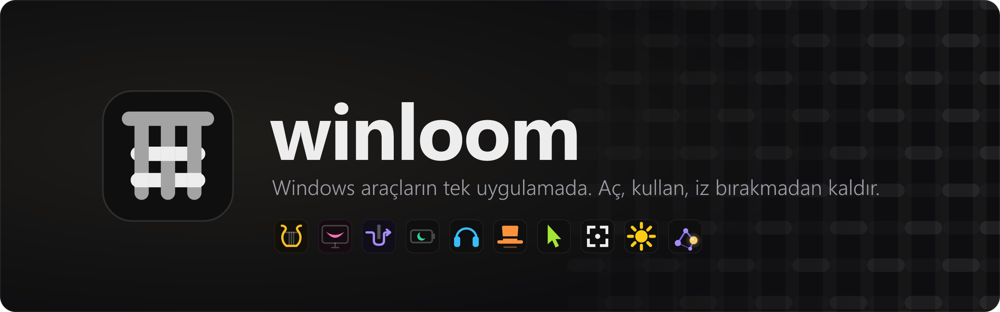
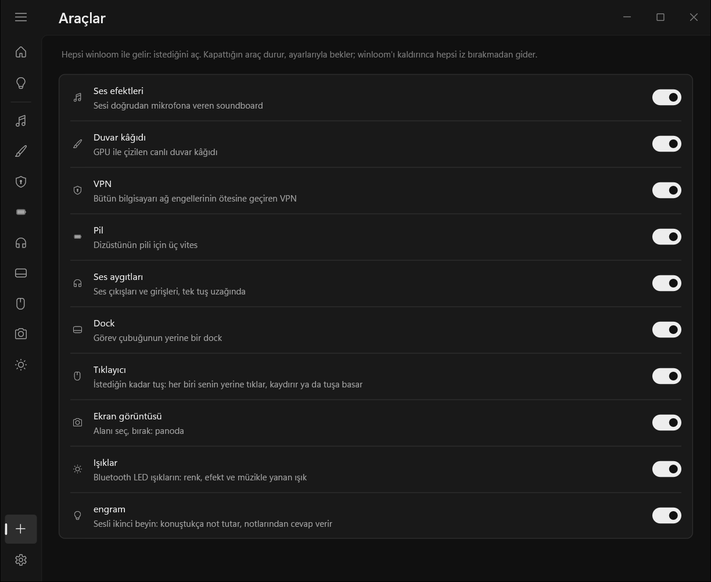
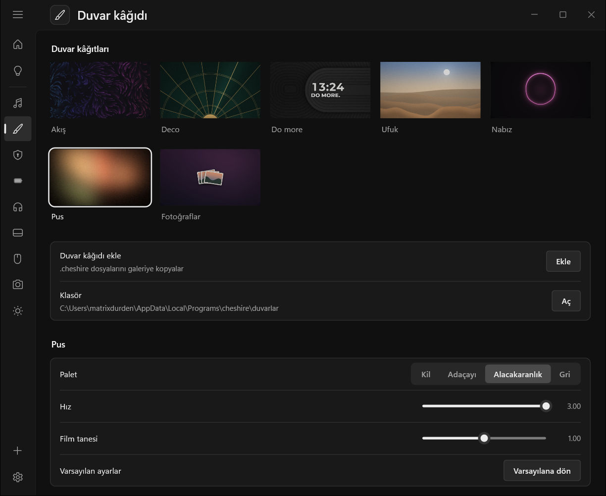

<p align="center">
  
</p>

<p align="center">
  <a href="https://github.com/matrixdurden/winloom/releases/latest"></a>
  
  
  <a href="LICENSE"></a>
</p>

<p align="center"><a href="README.md">English</a> · <b>Türkçe</b></p>

<br>

Bir soundboard, bir duvar kâğıdı programı, bir VPN, bir otomatik tıklayıcı, pil için bir şey daha… Windows'ta her küçük ihtiyaç ayrı bir program demek: her birinin kendi kurulumu, kendi tepsi ikonu, kendi güncelleyicisi ve kaldırınca geride bıraktığı kendi çöpü.

**winloom hepsini tek uygulamada toplar.** On araç aynı pencereyi, aynı tepsi ikonunu ve aynı güncelleyiciyi paylaşır. İstediğini açarsın, gerisi karşına çıkmaz. İşin bitince de winloom sisteme ne eklediyse son kayıt defteri anahtarına kadar geri alır.

## Kurulum

PowerShell'e yapıştır:

```powershell
irm https://github.com/matrixdurden/winloom/raw/main/install.ps1 | iex
```

Bu kadar: yönetici izni yok, kurulum sihirbazı yok. Sonrasında winloom kendini güncel tutar: yeni sürümü indirir, doğrular ve bir sonraki açılışta kurar (Ayarlar'dan hemen de kurulur, otomatik güncelleme kapatılabilir).

## İçinde neler var

Bütün araçlar winloom ile gelir ve kapalı başlar. **Araçlar** sayfasından istediğini aç: her biri kenar çubuğunda bir sayfa ve Başlat menüsünde kendi adıyla bir kısayol kazanır. "Pil" diye aratınca winloom doğrudan o araçta açılır.

### Ses

| | | |
|:---:|---|---|
|  | **Ses efektleri** | Sesleri doğrudan mikrofonuna verir, sanal mikrofon kurmadan: Discord, oyunlar, OBS, mikrofonu dinleyen her şey duyar. Myinstants'ta sayfadan çıkmadan ara (kulaklıkta dinle, tek tıkla ekle); bilgisayarda az önce çalan son 10 saniyeyi `Ctrl+Alt+L` ile listeye al. |
|  | **Ses aygıtları** | Bütün çıkışlar ve girişler tek listede; tıkladığın varsayılan olur. Bir tuş sonraki çıkışa (`Ctrl+Alt+O`) ya da girişe (`Ctrl+Alt+I`) geçer, bir tuş mikrofonu susturur (`Ctrl+Alt+K`). Kulaklık kopunca müzik laptop hoparlöründen devam etmez, durur. |

### Masaüstü

| | | |
|:---:|---|---|
|  | **Duvar kâğıdı** | Masaüstü ikonlarının arkasında ekran kartıyla çizilen canlı duvar kâğıtları. Fotoğraflar duvar kâğıdı kendi klasöründeki resimleri dokuz geçişle (çözülme, daire, bozulma…) değiştiren bir slayt gösterisine çevirir; ekrandaki fotoğraf yavaşça yakınlaşıp kayar. Her duvar kâğıdının üstüne saat, tarih, hava ya da kendi yazını koy, ekranının küçük önizlemesinde sürükleyerek yerleştir. Tam ekranda ve pilde kendiliğinden durur. |
|  | **Dock** | Görev çubuğunun yerine Windows 11 görünümünde yüzen bir dock: sabitlediğin ve açık uygulamalar tek çubukta, ucunda Wi-Fi, ses, pil ve saat. İmlecin altındaki simgeler büyür, seni bekleyen uygulama zıplar, üstünde durunca pencerelerinin canlı önizlemesi açılır, sürükleyerek sıralarsın. İmleci sol üst köşeye fırlatınca bütün pencereler, sağ alt köşeye fırlatınca masaüstü açılır; `Win+1…9` uygulamaları dock sırasıyla açar. Kapatınca görev çubuğu tam eski haline döner. |
|  | **Ekran görüntüsü** | `Print Screen` ekranı dondurur. Bir alan seç (ya da tıkla, bütün ekran), kenarlarından boyutla, taşı, üstüne kalemle ya da kareyle altı renkte çiz. `Ctrl+C` kopyalar, `Ctrl+S` PNG olarak kaydeder. Ekranda başka hiçbir şey araya girmez. |

### Ağ

| | | |
|:---:|---|---|
|  | **VPN** | Bütün bilgisayarı ağ engellerinin ötesine iki yoldan geçirir: **kendi sunucun** üzerinden, tanınmış bir siteye giden sıradan HTTPS kılığında, ya da **hiç sunucu olmadan** DPI modunda, site adlarını filtreden gizleyerek. Ağ testi, bulunduğun yerde hangisinin çalıştığını söyler. Motoru tek başına da çalışır, Linux sunucuda ve telefonda: bkz. [winloom VPN](araclar/tunnel/motor/). |

### Güç ve giriş

| | | |
|:---:|---|---|
|  | **Pil** | Dizüstü için üç vites: prizde, dışarıda bir iki saat ve hayatta kalma. Şarj takılıp çıkınca kendisi vites değiştirir, pildeyken harici ekran kartını uyutur ve her vitesin gerçekte kaç saat gittiğini öğrenir. |
|  | **Tıklayıcı** | İstediğin kadar tetik tuşu olan otomatik tıklayıcı. Her tuşun kendi eylemi (herhangi bir fare tuşu, tekerlek ya da Ctrl / Alt / Shift ile bir klavye tuşu), kendi modu (basılı tut ya da bir bas başlasın, bir bas dursun), iki saniyede birden saniyede yüze kadar kendi hızı ve kendi durma sayısı var. Tuşlar birbirinden bağımsız: biri kaydırırken öbürü tıklayabilir. |

### Ev ve hafıza

| | | |
|:---:|---|---|
|  | **Işıklar** | Bluetooth LED ışıkların masaüstünden: renk, parlaklık, ışığın kendi efektleri ve müziğin vuruşunda renk değiştiren ya da yanıp sönen ışık (bilgisayarda çalan her şey ya da yalnızca Spotify veya tarayıcı). Şimdilik STARLIGHT kontrolcüleri. |
|  | **engram** | Konuşarak kullandığın ikinci beyin. Sen konuştukça not tutar, notlarından cevap verir. Uyandırma sözünü söyle ya da tuşunu basılı tut; dinlerken ekranın kenarları yanar. Notların kendi klasöründe düz Markdown. Bir yapay zekâ API anahtarı ister. |

<br>

<table>
  <tr>
    <td width="50%"></td>
    <td width="50%"></td>
  </tr>
  <tr>
    <td align="center"><sub>Araçlar: her araç tek anahtar</sub></td>
    <td align="center"><sub>Duvar kâğıdı: canlı duvar kâğıtları ve ayarları</sub></td>
  </tr>
</table>

winloom İngilizce ve Türkçe konuşur. Windows'un görüntü dilini izler, Ayarlar'dan değiştirebilirsin.

## İz bırakmaz

Tek bir uygulama kurarsın, araçlar onun içinde gelir. Bir aracı kapatınca durur ve çalışırken değiştirdiğini geri alır: Dock görev çubuğunu geri getirir, Pil güç ayarlarını eski haline döndürür, VPN tüneli kapatır. Ayarların yerinde kalır, yeniden açınca kaldığın yerden devam edersin.

winloom'ı kaldırmak (Ayarlar'dan ya da Windows'un **Uygulamalar** listesinden) bir adım daha ileri gider: her aracın kurduğu her şeyi siler; dosyalar, kayıt defteri anahtarları, mikrofon ayarları, hizmetler, `PATH` girdileri, kısayollar. Sonra winloom bunların her birini tek tek denetler. Bir şey kalmışsa kaldırma bitmiş sayılmaz ve winloom tam olarak neyin kaldığını söyler.

```powershell
winloom --leftovers    # kurulu olmayan araçlardan geride bir şey kalmış mı?
```

## Derleme

winloom Rust ile yazılır ve WSL'den Windows için çapraz derlenir (`x86_64-pc-windows-gnu`, mingw gerekir). VPN motoru Go ile yazılır.

```sh
make build      # target/x86_64-pc-windows-gnu/release/winloom.exe
make install    # %LOCALAPPDATA%\Programs\winloom altına kur ve başlat
make motor      # VPN motorunu test et, Windows ve Linux için derle
make release    # Cargo.toml'daki sürümle GitHub'da yayın
```

| Klasör | İçinde ne var |
|---|---|
| [`merkez/`](merkez) | `winloom.exe`'nin kendisi: pencere, tepsi, araçları açıp kapatma, güncelleme, kurulum ve kaldırma |
| [`ortak/`](ortak) | Bütün araçların paylaştığı kod: çizim, arayüz parçaları, log, ağ, dil, araç sözleşmesi |
| [`araclar/<id>/`](araclar) | Her araca bir klasör: sayfası (`src/`), ikonu (`ikon/`) ve varsa motoru (`motor/`) |
| [`araclar/soundboard/apo/`](araclar/soundboard/apo) | Ses efektlerinin üzerinden çaldığı mikrofon efekti |
| [`araclar/wallpaper/motor/`](araclar/wallpaper/motor) | Duvar kâğıdı motoru ve [`.cheshire` formatı](araclar/wallpaper/motor/README.md#the-cheshire-format) |
| [`araclar/tunnel/motor/`](araclar/tunnel/motor) | Tek başına da çalışan VPN motoru (Go) |

Kendi aracını eklemek: [ARAC-EKLEME.md](ARAC-EKLEME.md).

## Lisans

MIT. VPN motoru, üzerine kurulduğu [sing-box](https://github.com/SagerNet/sing-box) gibi GPL-3.0.
